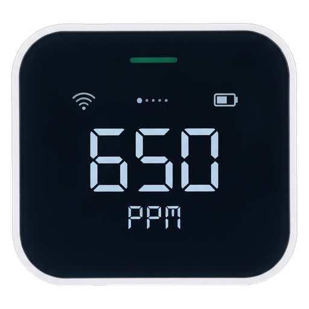
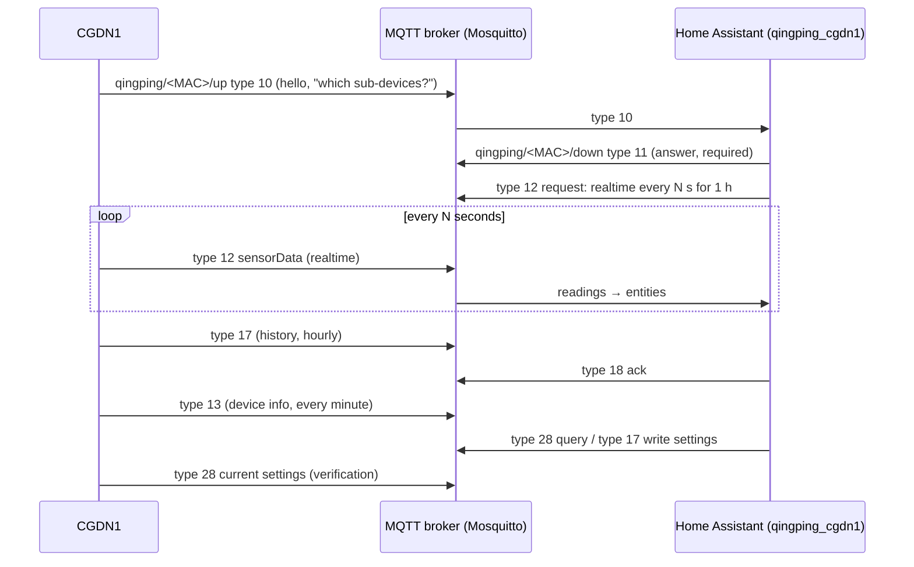

<p align="center">
  
</p>

<h1 align="center">QingPing CGDN1 for Home Assistant</h1>

<p align="center">
  Local, cloud-free integration for the <b>Qingping Air Monitor Lite (CGDN1)</b> over your own MQTT broker.<br>
  Realtime readings, on-device settings, a temperature filter, repairs and diagnostics. No Qingping cloud at runtime.
</p>

<p align="center">
  <a href="https://github.com/hacs/integration"></a>
  
  
  <a href="LICENSE"></a>
</p>

<p align="center">
  🇳🇱 <a href="docs/HANDLEIDING.md"><b>Nederlandstalige handleiding</b></a> ·
  📡 <a href="docs/PROTOCOL.md">Protocol notes</a> ·
  🔒 <a href="docs/PRIVACY.md">Privacy &amp; security</a> ·
  🔧 <a href="tools/qingping-ble-setup/README.md">Offline BLE setup tool</a>
</p>

---

## Contents

- [Why this integration](#why-this-integration)
- [Features](#features)
- [How it works](#how-it-works)
- [Requirements](#requirements)
- [Step 1: Point the monitor at your broker](#step-1-point-the-monitor-at-your-broker)
- [Step 2: Prepare the MQTT broker](#step-2-prepare-the-mqtt-broker)
- [Step 3: Install the integration](#step-3-install-the-integration)
- [Step 4: Add the device](#step-4-add-the-device)
- [Entities](#entities)
- [Update speed and realtime reporting](#update-speed-and-realtime-reporting)
- [Temperature filter](#temperature-filter)
- [Repairs](#repairs)
- [Recorder and logbook](#recorder-and-logbook)
- [Privacy and security](#privacy-and-security)
- [HomeKit](#homekit)
- [Troubleshooting](#troubleshooting)
- [FAQ](#faq)
- [Development](#development)
- [Credits](#credits)
- [License](#license)

---

## Why this integration

The Air Monitor Lite can reach Home Assistant in several ways, and each has a catch:

| Route | Catch |
|---|---|
| **HomeKit Controller** | Users report Wi-Fi drop-outs after a few days. Every sensor becomes a separate device. No settings. |
| **Core `qingping` (Bluetooth)** | Read-only, depends on BLE advertisements and a nearby adapter or proxy. No settings, no realtime control. |
| **Qingping cloud API** | Your readings go through Qingping's servers. Polling with a delay. |
| **Hand-written MQTT YAML** | Works, but no device registry, no settings, no availability, no acks: the device stops sending without type-11/18 answers. |

This integration talks to the monitor **directly over your local MQTT broker** using Qingping's
"Private Access" (privatization) feature. After the one-time setup, the device does not need the
internet at all.

## Features

- 🔍 **Zero-config discovery**: monitors that publish on `qingping/<MAC>/up` show up under *Discovered*.
- 📶 **Bluetooth provisioning**: a monitor in pairing mode is discovered over BLE (local adapter or
  ESPHome proxy) and pointed at your broker straight from Home Assistant. No account, no cloud, no app.
- ⚡ **Realtime readings**: temperature, humidity, CO₂, PM2.5, PM10 and battery every 5–120 s (your choice).
- 🛠️ **On-device settings from HA**: offsets (absolute and %), screen mode, night mode, auto power-off,
  clock format, temperature unit, CO₂ automatic calibration, sampling intervals and timezone.
  Every write is read back from the device and verified.
- 🕒 **Automatic timezone and DST** on the device clock.
- 🌡️ **Temperature filter**: removes the CGDN1's artificial jumps and spikes (self-heating
  compensation switching) and keeps the raw value as a separate, disabled-by-default sensor.
- 🩺 **Repairs**: device offline, sensor fault, and temperature step detected (with a fix flow to reset the correction).
- 🧾 **Diagnostics download**, with secrets and Wi-Fi identifiers removed.
- 📉 **Recorder friendly**: slow-changing values are throttled and noisy attributes are excluded from the database.
- 🔒 **Privacy by design**: the HomeKit salt, SSID and BSSID that the device broadcasts are never stored (see [PRIVACY.md](docs/PRIVACY.md)).
- 🌍 English and Dutch translations.
- ✅ Test suite (pytest-homeassistant-custom-component).

## How it works



Details are in [docs/PROTOCOL.md](docs/PROTOCOL.md).

## Requirements

- Home Assistant **2026.2** or newer (tested on 2026.2 and 2026.11).
- The **MQTT** integration and a broker. The official Mosquitto add-on is fine.
- A Qingping Air Monitor Lite **CGDN1** with stock firmware 4.x (tested with 4.8.5).
- Once, for provisioning, one of: Bluetooth in Home Assistant (adapter or ESPHome proxy), a PC with
  Bluetooth (Windows, macOS or Linux), **or** a Qingping account for the developer portal.

## Step 1: Point the monitor at your broker

Pick **one** of these routes. Route B needs no Qingping account and keeps your broker credentials local.

### Route A: Qingping developer portal (most common)

1. Add the monitor to the **Qingping+** or **Qingping IoT** app once, so it is linked to your account.
2. Log in with the same account at <https://developer.qingping.co> (use a desktop browser).
3. **Private Access Config → Configurations → Add configuration**:
   - Device model: *Qingping Air Monitor Lite*
   - Private type: **Self-built MQTT**
   - Host / port: your broker's **LAN** IP and port (e.g. `1883`)
   - User name / password: a dedicated broker user (see step 2)
   - Up topic: `qingping/{mac}/up`, down topic: `qingping/{mac}/down`
4. **Push configuration** → link the configuration to your device.
5. Reset the monitor's network settings (hold the top bar ~8 s until the large Wi-Fi icon) and
   set up Wi-Fi again in the app. The monitor fetches the MQTT config and starts publishing.
6. Optional but recommended: block the monitor's internet access afterwards (see [PRIVACY.md](docs/PRIVACY.md)).

> The portal stores your broker address and credentials on Qingping's servers. Route B avoids that.

### Route B: over Bluetooth, no account, no cloud (recommended)

**B1. From Home Assistant itself** (needs a Bluetooth adapter or an ESPHome Bluetooth proxy with
active connections near the monitor):

1. Put the monitor in pairing mode: hold the top bar about 8 s until the large Wi-Fi icon appears.
2. *Settings → Devices & services → Discovered → Qingping …* → **Set up over Bluetooth**.
3. Enter the Wi-Fi network, and the broker **LAN IP**, port and dedicated MQTT user (the host is
   prefilled from your MQTT integration).
4. The integration writes the settings over BLE, waits until the monitor publishes on
   `qingping/<MAC>/up`, and adds it.

The passwords are only used during the flow: they are not stored in the config entry and not
logged. This is deliberately a config flow and **not an action**: action data is fired as a
`call_service` event, which the recorder stores in the database, so a password in an action would
end up in plain text in `home-assistant_v2.db` and in automation traces.

**B2. From a PC:** [`tools/qingping-provision`](tools/qingping-provision/README.md), which uses the
same protocol code (bleak, MIT):

- **Windows 11 app:** `QingpingProvision.exe` from the [releases](https://github.com/GruttePier013/mqtt_qingping_air_monitor/releases)
  (no Python needed), or `start_gui.bat`. Scan, pick the monitor, enter Wi-Fi and broker, write.
- **Command line** (Windows, macOS, Linux):

```text
pip install -r tools/qingping-provision/requirements.txt
python tools/qingping-provision/qingping_provision.py scan
python tools/qingping-provision/qingping_provision.py provision --address 7C:C2:94:00:BE:F1 \
    --ssid MyIoTNetwork --mqtt-host 192.168.1.10 --mqtt-user qingping
```

The Wi-Fi MAC used in the topics is the **Bluetooth MAC minus 2** (confirmed on the CGDN1). Both
routes derive it automatically.

**B3. Original Linux tool:** [`tools/qingping-ble-setup`](tools/qingping-ble-setup/README.md) holds
[bitrate16/qingping](https://github.com/bitrate16/qingping) (AGPL-3.0, unmodified), the
reverse-engineering work this route is based on. It needs Linux with `gatttool`.

### Route C: ask Qingping support

Mail support with the device MAC and your broker details and ask for the "privatization function".
Same privacy trade-off as route A.

## Step 2: Prepare the MQTT broker

Give the monitors their **own broker user** with the minimum rights:

| Who | Topic | Right |
|---|---|---|
| monitor user (e.g. `qingping`) | `qingping/+/up` | write |
| monitor user | `qingping/+/down` | read |
| Home Assistant user | `qingping/#` | read + write |
| **everybody else** | `qingping/+/down` | **no write** |

> ⚠️ **Important:** the stock firmware accepts a firmware-update command (type 23) on the down topic and
> **does not verify signatures**. Anyone who can write to `qingping/<MAC>/down` can replace the firmware.
> Keep write access to the down topics limited to Home Assistant, and never expose the broker to the internet.

For the Mosquitto add-on, see [`examples/mosquitto/`](examples/mosquitto/) for a ready-to-adapt ACL
and the add-on `customize` options.

Check that messages arrive: **Settings → Devices & services → MQTT → Configure → Listen to a topic**
→ `qingping/#`. You should see a type 13 message about every minute.

## Step 3: Install the integration

### HACS (custom repository)

1. HACS → ⋮ → **Custom repositories** → add `https://github.com/GruttePier013/mqtt_qingping_air_monitor`, category *Integration*.
2. Search for **QingPing CGDN1** → *Download*.
3. Restart Home Assistant.

### Manual

Copy `custom_components/qingping_cgdn1` into `<config>/custom_components/` and restart Home Assistant.

## Step 4: Add the device

- **Automatic:** publishing monitors appear under **Settings → Devices & services → Discovered**. Click *Add* and give it a name.
- **Bluetooth:** a monitor in pairing mode also appears under *Discovered*; see [route B1](#route-b-over-bluetooth-no-account-no-cloud-recommended).
- **Manual:** *Add integration* → **QingPing CGDN1**. The flow listens on MQTT for 10 seconds and offers the
  monitors it hears. Otherwise, enter the 12-character MAC address used in the topic.

Each monitor is a separate config entry. The realtime **update interval** is the *Update interval*
number entity on the device page (5–120 s, default 15 s).

## Entities

Entity IDs are `<domain>.<device_name>_<key>`. Names are translated (English/Dutch).

### Measurements

| Entity | Unit | Notes |
|---|---|---|
| Temperature | °C | **Filtered** (see [Temperature filter](#temperature-filter)) |
| Temperature unfiltered | °C | Raw device value, *disabled by default* |
| Humidity | % | |
| CO2 | ppm | entity ID `…_carbon_dioxide` |
| PM25 / PM10 | µg/m³ | |
| Battery | % | Diagnostic, updated at most hourly |

### Diagnostics

| Entity | Description |
|---|---|
| Status | `realtime` (realtime reports arrive) / `online` (messages, but no realtime) / `offline` (5 min without any message). Attributes: `last_report`, `report_type`, `report_type_code`, `expected_every_s`, `device_timestamp`. Its `last_reported` is the exact time of the last message |
| Battery state | `discharging` / `charging` / `full` |
| Firmware, MAC address | Also written to the device registry |
| WiFi signal | RSSI in dBm (SSID/BSSID deliberately **not** exposed) |
| Sensor status | `OK` or `Fault: co2, pm25 …` from the per-sensor status flags |
| CO2 calibration state | As reported by the device |
| Extra data | Count of undocumented fields; the fields themselves are attributes (not recorded) |

### Configuration (written to the device)

| Entity | Range | Device key |
|---|---|---|
| Temperature offset | −10 … +10 °C | `temperature_offset` (×100) |
| Temperature offset % | −10 … +10 % | `temperature_zoom` (×10) |
| Humidity offset | −20 … +20 % | `humidity_offset` (×10) |
| CO2 offset | −500 … +500 ppm | `co2_offset` |
| CO2 offset % | −50 … +50 % | `co2_zoom` (×10) |
| PM2.5 / PM10 offset | −500 … +500 µg/m³ | `pm25_offset`, `pm10_offset` |
| Auto power-off | 0–60 min (battery only, 0 = never) | `power_off_time` |
| Screen off after | 0–600 s ¹ | `display_off_time` |
| Screensaver delay | 0–600 s | `auto_slideing_time` |
| Timezone | −12 … +14 h, slider, step 1 h (auto-managed, DST aware) | `timezone` (×10) |
| PM / CO2 sampling interval | raw value ², *disabled by default* | `pm_sampling_interval`, `co2_sampling_interval` |
| Screen mode | rotating / current / time + rotating / time + current | `screensaver_type` |
| Display temperature unit | °C / °F | `temperature_unit` |
| Clock format | 24h / 12h | `is_12_hour_mode` |
| CO2 automatic calibration | on/off | `co2_asc` |
| Night mode start / end | time | `night_mode_start_time`, `night_mode_end_time` (minutes) |
| Update interval | 5–120 s, slider, step 5 s | integration-side (realtime interval) |
| Temperature step correction | −5 … +5 °C | integration-side correction (restored after restart) |

¹ Qingping support has called `display_off_time` "useless" and it has no visible effect on recent firmware.
² The unit of the sampling intervals is undocumented for the CGDN1.

## Update speed and realtime reporting

By default the CGDN1 reports every 15 minutes. The integration:

1. Asks for **realtime** reports (type 12) at your *update interval* (default 15 s) for one hour, and
   re-arms that request every 55 minutes. A watchdog re-arms it sooner if realtime data stops.
2. Sets the device's own history `report_interval` and `collect_interval` to one hour, so the stored
   history (type 17) is uploaded rarely and quickly acknowledged.
3. Ignores stale history entries (older than 2 minutes) for the live state.

Lower intervals mean more Wi-Fi traffic and a little more self-heating of the device.

## Temperature filter

The CGDN1 corrects its temperature for internal heating (screen, Wi-Fi, charging). When that
compensation switches, the reported temperature **jumps** by one or more degrees within seconds,
which is physically impossible in a room. The filter has three layers:

1. **Step correction**: a change of ≥ 1.0 °C between two samples less than 120 s apart is treated as an
   artefact. The jump is absorbed into a *correction* (max ±5 °C) and a repair issue is raised.
2. **Outlier removal**: a sample more than 0.5 °C away from the median of the last 6 samples is dropped.
3. **Low-pass** with a time constant of about 4 samples.

The **Temperature unfiltered** sensor (disabled by default) always shows the raw value. If the level
*after* a jump was actually the correct one, use the repair's fix flow (or the *Temperature step
correction* number) to reset the correction to 0.

## Repairs

| Issue | When | Clears |
|---|---|---|
| **Offline** | No message for > 5 min (also for a device that was never seen) | automatically on the next message |
| **Sensor fault** | A sensor reports a non-zero status | automatically when all report OK |
| **Temperature step corrected** | The filter absorbed a jump | acknowledge or reset the correction |

All issues of a device are removed when its config entry is deleted.

## Recorder and logbook

- Diagnostic sensors that change rarely (battery) are throttled to hourly, and
  *Extra data* to 5 minutes.
- Bulky attributes (Wi-Fi details, sensor flags, extra fields) are marked **unrecorded**.
- **Last message without logbook noise.** There is no separate "Last seen" sensor (a timestamp that
  changes on every message is a logbook entry per message, and `logbook: exclude` does **not** apply on
  the device page). Instead the **Status** sensor:
  - only changes state on a real transition (`realtime` / `online` / `offline`);
  - rewrites its `last_report` attribute at most once a minute (not recorded);
  - is re-reported on every message, so Home Assistant updates `last_reported`: no event, no logbook
    entry, no new database row.

  Show the last message time in a dashboard with a Markdown card:

```yaml
type: markdown
content: >-
  Last message: {{ relative_time(states.sensor.woonkamer_status.last_reported) }} ago
```

A full example that records only temperature, humidity and CO₂ is in
[`examples/recorder.yaml`](examples/recorder.yaml).

## Privacy and security

Short version, with the full analysis in [docs/PRIVACY.md](docs/PRIVACY.md):

- **At runtime nothing leaves your LAN.** The integration only talks to your broker.
- **Setup via the portal** (routes A and C) stores your broker address and credentials at Qingping. Route B avoids that.
- The **device** contacts Qingping/Xiaomi endpoints while it has internet: firmware checks, weather by
  public-IP location, and pairing status. Block its internet after setup and answer its DNS lookups
  locally to avoid a DNS storm.
- The device's MQTT is **plain TCP**. Keep it on a trusted or IoT VLAN.
- Type 13 contains your **SSID, router BSSID and a HomeKit salt**. This integration drops them on
  arrival: they are not in entities, attributes, the database or diagnostics.
- **Firmware updates over MQTT are unsigned.** Restrict write access to the down topics (see step 2).

## HomeKit

HomeKit is **not a switch** on this device: it is a different pairing route. The monitor is set up
either through the Apple Home app / HomeKit Controller, or through the Qingping apps or MQTT
provisioning. Neither the developer portal, MQTT nor the BLE tool can enable HomeKit. To move back to
HomeKit, reset the network settings (hold the top bar ~8 s) and add the device in the Home app with
the code on the device.

## Troubleshooting

| Symptom | Check |
|---|---|
| Nothing under *Discovered* | Listen to `qingping/#` in the MQTT settings. No messages means the broker address, user or ACL is wrong, or the device has no Wi-Fi. |
| Messages arrive but entities stay *unavailable* | The device waits for the type-11 answer. Check that the HA MQTT user may **write** `qingping/+/down`. |
| Updates only every 15 min | The realtime request is not arriving: same ACL check. Look at the *Status* (`online` instead of `realtime`, attribute `report_type`) and the debug log. |
| Settings don't stick | Open diagnostics: `settings.raw` shows what the device reported last. Some keys (`display_off_time`) are ignored by the firmware. |
| Wrong clock | The timezone is managed automatically. Make sure the HA timezone is right. |
| Offline repair after a restart | Normal until the first message. It clears itself. |

Debug logging:

```yaml
logger:
  logs:
    custom_components.qingping_cgdn1: debug
```

When opening an issue, attach the **diagnostics** download (Settings → Devices → your monitor → ⋮ → *Download diagnostics*).

## FAQ

**Does it work with the CGS1 / CGS2 / CGP22C?**
Not yet. The CGS1 and CGS2 use the same JSON protocol with extra fields (tVOC, noise), so support is
feasible. The CGP22C uses a binary protocol. Pull requests are welcome.

**Can I use MQTT over TLS, or HTTPS push?**
Not locally. The Bluetooth setup protocol only carries `host port username password`, with no TLS
flag, and nothing points to TLS support for self-built MQTT on the CGDN1. Qingping's HTTPS data
push runs from **their cloud** to your server, so it doesn't keep data local. Isolate the monitors on an
IoT VLAN instead (see [PRIVACY.md](docs/PRIVACY.md)).

**Why a config flow and not an action for Bluetooth setup?**
Action data is stored in the database as a `call_service` event, and would include the Wi-Fi and MQTT passwords.

**Can I turn off the LED or Bluetooth?**
There is no MQTT setting for either. The device only exposes LED *thresholds*, and there is no
BLE-related key in its settings.

**Is there a CO₂ calibration button?**
Only the automatic calibration (ASC) switch is exposed. A forced calibration command has not been
confirmed for this firmware.

**Qingping is building an official integration. Why this one?**
Their `qingpingiot` integration was not in Home Assistant core at the time of writing. This one focuses
on the CGDN1: the temperature filter, write verification, repairs, privacy redaction and the offline
provisioning route.

## Development

```bash
python -m venv .venv && . .venv/bin/activate
pip install -r requirements_test.txt
pytest
```

CI runs `hassfest`, the HACS validation and the test suite on every push (see `.github/workflows/`).

Repository layout:

```
custom_components/qingping_cgdn1/   the integration (MIT)
tests/                              pytest suite
docs/                               protocol, privacy, Dutch guide
examples/                           Mosquitto ACL, recorder/logbook, automation
tools/qingping-provision/           cross-platform BLE provisioning CLI (Windows/macOS/Linux, MIT)
tools/qingping-ble-setup/           original Linux BLE tool (bitrate16, AGPL-3.0, unmodified)
```

## Credits

- [mash2k3/qingping_cgs1](https://github.com/mash2k3/qingping_cgs1) (MIT): the original code base this integration grew from.
- [titovskiy/qingping_air_monitor_lite_CGDN1](https://github.com/titovskiy/qingping_air_monitor_lite_CGDN1): CGDN1 fork.
- [GreyEarl/qingping-air-monitor-mqtt](https://github.com/GreyEarl/qingping-air-monitor-mqtt): Private Access instructions.
- Kevin6872/qingping-air-monitor-lite: ideas for verified settings writes and device value scaling (no code copied).
- [bitrate16/qingping](https://github.com/bitrate16/qingping): BLE provisioning protocol and tool.
- [nemethhh/esphome-qingping-cgdn1](https://github.com/nemethhh/esphome-qingping-cgdn1): stock firmware analysis (OTA over MQTT).

Not affiliated with or endorsed by Qingping Technology (Beijing) Co., Ltd. "Qingping" is a trademark of its
owner. The integration icon shows the Qingping Air Monitor Lite product and is used only to identify the
supported device; all rights to that image remain with Qingping.

## License

- Integration, tests, docs and examples: **MIT** (see [LICENSE](LICENSE)).
- `tools/qingping-provision/` and `custom_components/qingping_cgdn1/ble_provision.py`: **MIT**, an independent
  implementation of the documented setup protocol.
- Third-party notices (AGPL tool, product image): [NOTICE.md](NOTICE.md).
- `tools/qingping-ble-setup/`: **AGPL-3.0-or-later**, © bitrate16. It is a separate program, shipped
  unmodified for convenience (see its [LICENSE](tools/qingping-ble-setup/LICENSE) and
  [UPSTREAM.md](tools/qingping-ble-setup/UPSTREAM.md)). The integration does not import it.
